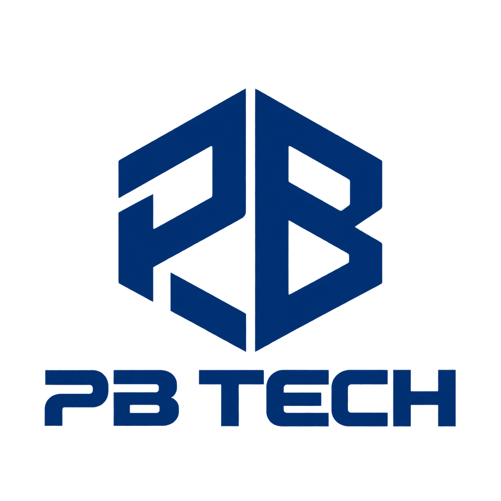

<p align="center">
  
</p>

<h1 align="center">Peterson Carousel Harness</h1>

<p align="center">
  <strong>Carrosséis com identidade de marca, decisões rastreáveis e revisão de qualidade.</strong><br>
  Um núcleo editorial modular para organizar texto, conceito visual, imagens e renderização.
</p>

<p align="center">
  
  
  
  
</p>

<p align="center">
  <a href="#projeto">O projeto</a> ·
  <a href="#estado">Estado atual</a> ·
  <a href="#fluxo">Fluxo editorial</a> ·
  <a href="#nucleo">Núcleo</a> ·
  <a href="#desenvolvimento">Desenvolvimento</a> ·
  <a href="#documentacao">Documentação</a>
</p>

<a id="projeto"></a>

## O projeto

O Peterson Carousel Harness organiza a produção de carrosséis desde a narrativa até os arquivos finais, preservando o que foi usado e aprovado em cada etapa. Aqui, *harness* é a camada que coordena os componentes, seus dados e suas regras de execução.

A proposta é ajudar criadores, profissionais de conteúdo e equipes que produzem para diferentes marcas a reduzir retrabalho:

- Reutilizar a identidade correta sem misturar preferências entre marcas.
- Preservar os logotipos originais e registrar os recursos usados em cada produção.
- Revisar uma amostra antes de gerar o lote completo.
- Retomar o trabalho com decisões e aprovações registradas, sem depender da memória de uma conversa.

<a id="estado"></a>

## Estado atual

> **Em desenvolvimento.** Já existem serviços internos, renderizadores e testes. A experiência completa ainda não está integrada à CLI nem ao plugin.

| Área | Situação |
| --- | --- |
| Código desta versão pública | Implementação até T15, com as etapas de composição e qualidade já incorporadas. |
| T16 / T17 | Invalidação de etapas e controle de execução ainda fora deste snapshot público. |
| Q05 | Verificação confiável da revisão editorial em implementação, fora deste snapshot. O consentimento da amostra permanece bloqueado por padrão. |
| CLI pública | Somente ajuda e versão. |
| npm | `@pb/carousel-harness` é o nome do manifesto. O pacote permanece `private: true` e não foi publicado. |
| Fichas de composição | As cinco fichas permanecem `candidate`, sem liberação estética para produção. |

Passar nos testes técnicos não libera automaticamente um layout ou uma entrega. Os [relatórios de testes](docs/testing/) registram evidências e limites de cada etapa; não certificam um produto integrado.

<a id="fluxo"></a>

## O fluxo editorial que estamos construindo

1. **Texto (copy):** preparar e versionar a narrativa, os títulos e o conteúdo de cada lâmina.
2. **Conceito e assets:** definir a direção visual, escolher a composição e reunir os recursos criativos. O logotipo continua separado como recurso da marca.
3. **Amostra:** renderizar uma seleção representativa de lâminas e emendas para avaliar a direção antes de produzir tudo.
4. **Revisão e aprovação:** conferir qualidade objetiva e editorial; registrar o consentimento sobre a versão exata apresentada.
5. **Lote:** produzir o conjunto completo com os mesmos recursos e decisões aprovadas, seguido de nova verificação de qualidade.
6. **Entrega:** reunir os arquivos finais e seus manifestos de integridade.

Essa sequência descreve a visão do fluxo completo. Os contratos, componentes e testes já cobrem partes dela, mas a integração produtiva de ponta a ponta continua pendente. As [skills editoriais](skills/) ajudam a preparar o material; sua presença não comprova um plugin integrado.

<a id="nucleo"></a>

## O que já existe no núcleo

### Marca e recursos

- **Memória de marca:** cadastro e revisões imutáveis, com identidade, temas e preferências confirmadas. Ajustes de um carrossel ficam separados das preferências permanentes; consultas preservam o isolamento entre marcas. [Evidência técnica](docs/testing/t08-brand-memory.md)
- **Logotipos PNG:** importação validada, preservação dos bytes originais e associação explícita a superfícies claras ou escuras. O núcleo não recolore, recorta ou inventa variantes. [Evidência técnica](docs/testing/t09-png-logos.md)
- **Snapshots de execução:** registro congelado da marca, tema, recursos e runtime utilizados. Uma revisão posterior da marca não muda silenciosamente uma produção existente. [Evidência técnica](docs/testing/t11-run-snapshots.md)

### Execução e aprovações

- **Persistência e integridade:** SQLite para metadados e estado; arquivos locais imutáveis identificados por hash. Operações transacionais e idempotentes evitam duplicar resultados quando uma solicitação é repetida. [Operações](docs/testing/t06-atomic-operations.md) · [Arquivos imutáveis](docs/testing/t07-immutable-files.md)
- **Estados e concorrência:** máquina de estados, consulta de pendências e *leases* por execução. Esses mecanismos de posse temporária usam tokens para impedir que um executor antigo confirme mudanças após perder a posse. [Estados](docs/testing/t13-run-state-machine.md) · [Leases](docs/testing/t14-run-leases.md)
- **Consentimento vinculado ao conteúdo:** aprovações de texto, conceito, assets e amostra referenciam os objetos e versões correspondentes. Um campo `approved: true` não substitui confirmação humana. [Evidência e limites](docs/testing/t15-approvals.md)

### Composição e qualidade

O compositor modular já inclui seleção real de amostra, contratos de evidência e verificações de texto, geometria, tipografia, contraste e integridade. A rubrica editorial exige avaliação humana; as verificações automáticas, sozinhas, não comprovam qualidade estética.

Veja o [compositor](docs/testing/quality-compositor.md), o [estado das evidências](docs/testing/quality-state.md) e a [qualificação visual](docs/testing/layout-qualification.md). Todas essas capacidades são internas e mantêm os bloqueios descritos em [Estado atual](#estado).

## Arquitetura e organização

A arquitetura prevê **CLI, plugin e distribuição npm usando os mesmos serviços e o mesmo armazenamento local**. O plugin não terá uma memória paralela. O histórico de conversa não será a fonte de verdade de aprovações ou arquivos.

O primeiro alvo de produto é Windows x64, com um proprietário por instalação e marcas separadas. Este módulo não oferece sincronização entre computadores, serviço em nuvem, editor gráfico ou publicação automática no Instagram.

| Diretório | Responsabilidade |
| --- | --- |
| [`src/domain/`](src/domain/) | Contratos, fingerprints, políticas e estados. |
| [`src/application/`](src/application/) | Memória, arquivos, execuções e aprovações. |
| [`src/infrastructure/`](src/infrastructure/) | SQLite, filesystem e recursos. |
| [`src/render/`](src/render/) | Composição e renderização. |
| [`src/quality/`](src/quality/) | Verificações objetivas e rubrica editorial. |
| [`skills/`](skills/), [`shared/`](shared/) e [`scripts/`](scripts/) | Preparação editorial, schemas e ferramentas existentes. |
| [`tests/`](tests/) e [`docs/testing/`](docs/testing/) | Testes e registros de evidência técnica. |

O logotipo PB TECH exibido neste README é um recurso da documentação. Ele não define a marca padrão de novos carrosséis nem é aplicado automaticamente pelo núcleo.

<a id="desenvolvimento"></a>

## Desenvolvimento local

### 1. Confira o runtime

Use **Node.js 24.21.0**, versão declarada em [`package.json`](package.json), e npm. As dependências incluem componentes nativos; a [matriz de runtime](docs/architecture/runtime-matrix.md) delimita o ambiente qualificado e os requisitos. Testes em Linux não equivalem à homologação do produto nesse sistema.

### 2. Prepare uma cópia de desenvolvimento

```sh
git clone https://github.com/Peterson-Benhame/pb-carousel-harness.git
cd pb-carousel-harness
npm ci --ignore-scripts --include=optional --no-audit --no-fund
```

Esse comando usa o lockfile existente e não executa scripts de instalação. Isso pode deixar addons nativos sem preparar. Antes dos testes, provisione e verifique os addons conforme a [matriz de runtime](docs/architecture/runtime-matrix.md). A opção `--ignore-scripts`, sozinha, não entrega um ambiente pronto; não há garantia de suporte a qualquer plataforma.

### 3. Explore a CLI mínima

Os comandos abaixo mostram a interface disponível sem criar diretórios de dados nem carregar SQLite ou o renderer:

```sh
node bin/peterson-carousel.mjs --help
node bin/peterson-carousel.mjs --version
node bin/peterson-carousel.mjs --version --json
```

Não há comandos públicos de produção, plugin integrado ou fluxo `npx` homologado. A [documentação da CLI](docs/cli.md) detalha os limites e o empacotamento interno.

### 4. Execute os testes no ambiente preparado

Com os addons disponíveis e verificados:

```sh
npm test
```

A qualificação nativa Windows é separada:

```sh
npm run test:qualification
```

Esses comandos verificam seus respectivos escopos técnicos. A liberação estética e a integração do produto continuam sujeitas às etapas pendentes.

<a id="documentacao"></a>

## Documentação

| Para entender… | Comece por… |
| --- | --- |
| O escopo e os requisitos do módulo | [Especificação v0.3](docs/plans/module-01/baseline-reference/ESPECIFICACAO-v0.3.md) |
| O fluxo de composição e revisão de qualidade | [Adendo de qualidade v0.4](docs/plans/module-01/ESPECIFICACAO-ADENDO-QUALIDADE-v0.4.md) |
| A sequência de implementação | [Plano do módulo 01](docs/plans/module-01/PLANO.md) e [plano de qualidade](docs/plans/module-01/PLANO-REVISAO-QUALIDADE.md) |
| Os contratos de qualidade e evidência | [Contrato de qualidade](docs/architecture/quality-contract.md) |
| O ambiente nativo e seus limites | [Matriz de runtime](docs/architecture/runtime-matrix.md) |
| As fontes e suas condições de uso | [Recursos tipográficos](docs/architecture/quality-font-gate.md) |
| A interface e o pacote interno | [CLI mínima](docs/cli.md) |
| O que foi verificado em cada etapa | [Relatórios técnicos](docs/testing/) |

Os planos incluem requisitos futuros e registros históricos; não são uma lista de funcionalidades entregues. Para a situação desta versão, consulte [Estado atual](#estado) e os relatórios de cada componente.

## Atribuição e condições de uso

Inspirado em [Carousel Suite](https://github.com/tenfoldmarc/carousel-suite-skill), de [@tenfoldmarc](https://github.com/tenfoldmarc). A atribuição e os limites de publicação estão em [ATTRIBUTION.md](ATTRIBUTION.md). Esta cópia pública é sanitizada e não inclui o histórico privado de trabalho nem artefatos pessoais.

**Nenhuma nova licença de projeto é concedida.** O pacote permanece `private: true`, com staging `UNLICENSED`; publicar o código no GitHub não autoriza distribuir o pacote npm ou tarball.

Os avisos OFL de Anton, Manrope e JetBrains Mono permanecem em [`assets/fonts/`](assets/fonts/). No produto e na distribuição planejados, fontes são recursos externos: seus binários não integram o pacote npm, o ZIP de entrega nem o backup.
